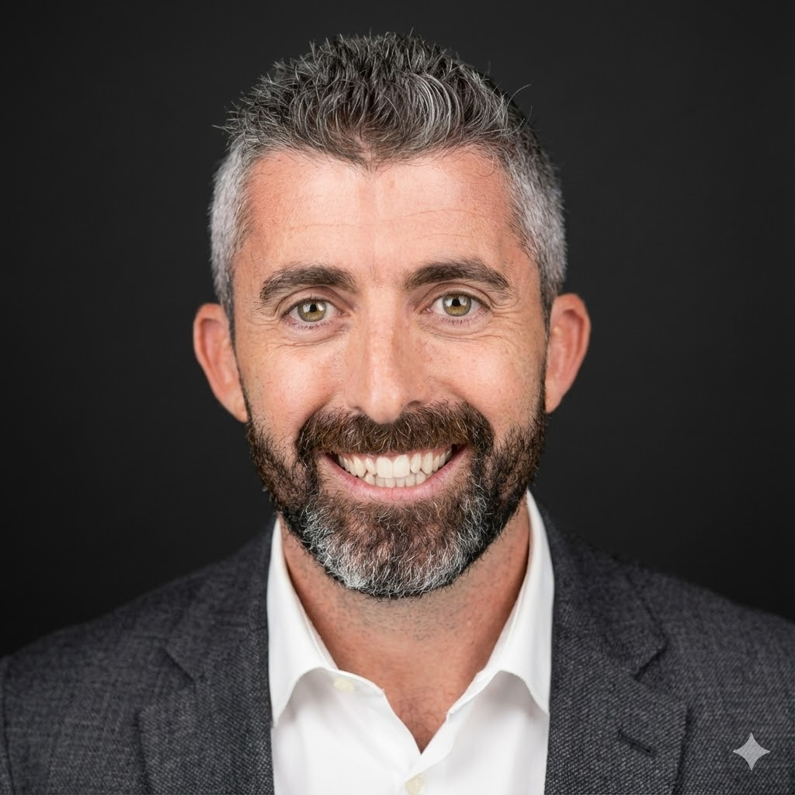

<h1 style="margin-bottom:10px;">Andrea Capasso</h1>

<strong>Research Scientist – Principal Investigator </strong>

<strong> Head of Laboratory </strong> / 2D Crystal Fab

<strong> Coordinator </strong> / Transversal Line on Advanced Materials

International Iberian Nanotechnology Laboratory (INL), Braga, Portugal

 

<strong>Co-Lead</strong> / Working Group 4 – Electronics, IAM-I

 

<strong> Editor </strong> / Diamond and Related Materials (Elsevier)

 
<a href="mailto:andrea.capasso@inl.int">
  andrea.capasso@inl.int
</a> |
<a href="https://scholar.google.com/citations?user=lSos5ssAAAAJ&hl=pt-PT&oi=ao" target="_blank">
  Google Scholar
</a> |
<a href="https://orcid.org/0000-0003-0299-6764" target="_blank">
  Orcid
</a> |
<a href="https://inl.int/community/andrea-capasso/" target="_blank">
  inl.int
</a>

<h2 style="text-align:left; margin-top:10px;">Education</h2>

  
Ph.D. 2012

  
Queensland University of Technology / Materials Science

  
Laurea (Integrated MSc) 2007 

  
University of Roma Tre / Electronic Engineering

<h2 style="text-align:left; margin-top:10px;">Professional Experience</h2>

  
Diamond and Related Materials / Editor

2026 – present

INL / Head of Laboratory, 2D Crystal Fab

2025 – present

IAM-I / Co-Lead, Working Group 4 – Electronics

2025 – present

INL / Coordinator, Transversal Line on Advanced Materials

2025 – present

University of Minho / Guest Lecturer

2024 – present

INL / Research Scientist – Principal Investigator

2018 – present

Yonsei University / Research Scientist

2018

Italian Institute of Technology / Researcher

2014 – 2017

ENEA Casaccia Research Centre / Research Fellow

2013 – 2014

Queensland University of Technology / Postdoctoral Research Fellow

2011 – 2012

<h2 style="text-align:left; margin-top:10px;">Selected Publications</h2>

<li>
  “Stable Graphene Membranes for Selective Ion Transport and Emerging Contaminants Removal in Water” Advanced Functional Materials (2023) 
</li>

<li>
  “Bipolar Resistive Switching in 2D MoSe2 Grown by Atmospheric Pressure Chemical Vapor Deposition” ACS Applied Materials & Interfaces (2024)
</li>
 
<li>
  “Sustainable MXene Membranes for Ion Sieving and Antibacterial Water Purification” Journal of Membrane Science (2026)
</li>
 
<li>
  “Multifunctional Superhydrophobic TiB2@Ag Composite-Based Fabric with Broadband Solar Absorption for Efficient Anti-Icing and Photothermal De-Icing” Chemical Engineering Journal (2026) 
</li>

 
<!-- AUTOMATIC LATEST NEWS SECTION -->
<h2 style="text-align:left; margin-top:30px;">Latest News</h2>

  
  

    <!-- Text -->
    

      <h3 style="margin-top:0; margin-bottom:8px;">{{ item.title }}</h3>
      
{{ item.description }}

      
{{ item.date }}

    

    <!-- Image -->
    
    

      
    

    

  

  

