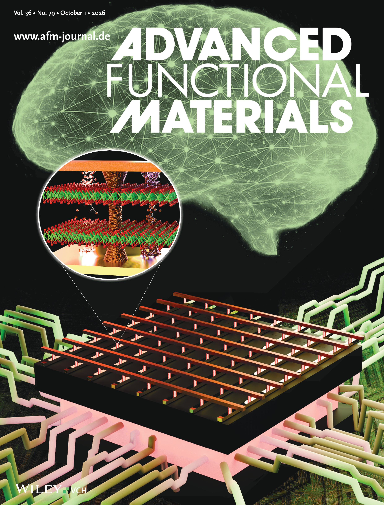

<!-- SIDE-BY-SIDE SECTION -->

  <!-- LEFT: SLIDESHOW CONTAINER -->
  

    

      
    

  

      
    

  

      
    

  

  <!-- RIGHT: WELCOMING TEXT CONTAINER -->
  

    <h2>Welcome to 2D Crystal Fab</h2>
    

      We are an interdisciplinary research group focused on the synthesis, advanced characterization, and device integration of novel two-dimensional (2D) nanomaterials and heterostructures.
    

    

      Our lab explores cutting-edge applications spanning flexible electronics, memristive neural interfaces, sustainable energy storage, and bio-sensing technologies.
    

  

<!-- LIGHTBOX OVERLAY -->

  &times;
  

<!-- SCRIPT FOR AUTOMATIC SLIDESHOW & LIGHTBOX -->

<!-- AUTOMATIC LATEST NEWS SECTION -->
<h2 style="text-align:left; margin-top:30px;">Latest News</h2>

  
  

    <!-- Text -->
    

      <h3 style="margin-top:0; margin-bottom:8px;">{{ item.title }}</h3>
      
{{ item.description }}

      
{{ item.date }}

    

    <!-- Image -->
    
    

      
    

    

  

  

